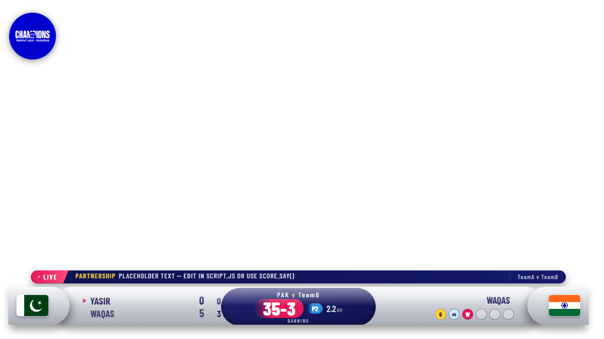
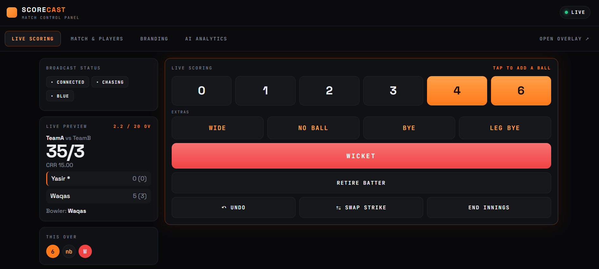

# Score Cast

**Score Cast** is a cricket scoring and broadcast suite by **The Bug Busters**. It combines a scorer panel, live scoreboard overlay, and optional AI match reports for community matches.

## Project and team

| Team member | GitHub |
| --- | --- |
| Sagar Habib | [@sagardaudpota](https://github.com/sagardaudpota) |
| Muhammad Zaid | [@ZAIDDIV](https://github.com/ZAIDDIV) |
| Muhammad Suleman Memon | [@sulemanbuilds](https://github.com/sulemanbuilds) |

## Theme and community problem

**Theme: Public Services.** Local cricket often lacks accessible broadcast scoring, making it harder for spectators and remote viewers to follow. Score Cast provides a live scoreboard and uses AI to turn match data into readable insights for the community.

## Screenshots

These screenshots provide a quick look at the project:

| Score Cast screenshot 1 | Score Cast screenshot 2 |
| --- | --- |
|  |  |

## Live deployment and demo

- **Live project:** [scorecast.sulemanbuilds.com](https://scorecast.sulemanbuilds.com)
- **Demo video:** [Watch the Score Cast demo](https://drive.google.com/drive/folders/1I_YvGNYQrB6KTJGU-vUqgijTUY6IO2Wh?usp=sharing)

## What the project includes

### Landing page

Root [`index.html`](index.html) links to the scorer and viewer screens. Its styles and animations are in [`assets/landing.css`](assets/landing.css) and [`assets/landing.js`](assets/landing.js).

### Scorer panel

[`admin/scorer_panel.html`](admin/scorer_panel.html) handles match/player setup, ball-by-ball scoring, batter/bowler updates, undo, innings controls, and AI Analytics. It communicates with PHP endpoints in `admin/`.

### Viewer scoreboard overlay

[`frontend/index_blue.html`](frontend/index_blue.html) is the live overlay for browsers and OBS. It shows score, players, overs, recent balls, ticker, and match details with event animations. [`frontend/index_blue_need.html`](frontend/index_blue_need.html) is the alternate chase view; logic, styles, and images live in [`frontend/assets/`](frontend/assets/).

### Match management and API

PHP endpoints read and update JSON records in [`admin/matches/`](admin/matches/). `active_match.json` selects the current match; `update_score.php` saves changes and `get_score.php` serves the overlay. Other endpoints generate and publish AI reports.

## How AI is used

- **Model/API:** DeepSeek `deepseek-flash`, called through the DeepSeek Chat Completions API (`https://api.deepseek.com/chat/completions`).
- **Input:** The server reads the selected match's JSON record. This includes available match details and structured score data such as teams, innings, runs, wickets, overs, batter/bowler figures, and ball-by-ball events. The scorer selects one or more report types to request.
- **Output:** The API returns structured text reports for **player insights**, **turning points**, **chase analysis**, and **post-match reports**. The live integration saves generated reports with that match. They remain hidden from the public overlay until the scorer explicitly publishes them.
- **Credential handling:** The API key belongs in the server-only `admin/private/deepseek_config.php` file, which is excluded by `.gitignore`. It must not be put in browser JavaScript, HTML, or match data.

AI summaries make match data easier to share. Scorers should review reports before publishing.

## Tech stack

- **Frontend:** HTML5, CSS3, and vanilla JavaScript.
- **Animation and presentation:** GSAP 3.12.5, Barlow and Barlow Condensed fonts; the standalone AI demo page also uses Bootstrap 5.3.3.
- **Backend:** PHP with JSON HTTP endpoints and cURL for the DeepSeek API call.
- **Storage:** JSON files for active match selection, match records, and undo snapshots.
- **Broadcast use:** Browser-based scoreboard overlay designed to fit a 1920×1080 stage and scale to the browser viewport; usable as an OBS Browser Source.

There is no Node/npm build process or Composer dependency setup in this repository.

## Run locally

### Requirements

- XAMPP (or another local Apache/PHP server).
- PHP with JSON support. PHP cURL is required for AI reports.
- A modern browser. Internet access is needed for the external fonts, GSAP, and optional AI API calls.

### Setup

1. Clone or copy this repository into your web server document root, for example `C:\xampp\htdocs\the-bug-busters`.
2. Start Apache in the XAMPP Control Panel.
3. Open the landing page at `http://localhost/the-bug-busters/`.
4. Open the scorer at `http://localhost/the-bug-busters/admin/scorer_panel.html`.
5. Open the overlay at `http://localhost/the-bug-busters/frontend/index_blue.html`. For OBS, add this URL as a Browser Source and set the source dimensions to your broadcast output.
6. Create or select a match in the scorer, set the teams and player details, and enter deliveries. Keep the overlay open to see the current match display.

Serve the app over HTTP through Apache rather than opening the HTML files directly with `file://`; browser file mode cannot use the PHP endpoints. PHP needs write access to `admin/matches/` and the score lock file for live scoring.

### Optional: configure AI reports

1. Copy [`admin/private/deepseek_config.example.php`](admin/private/deepseek_config.example.php) to `admin/private/deepseek_config.php`.
2. Add your DeepSeek API key to the local server config. Keep the real config out of source control.
3. Ensure the PHP cURL extension and outbound HTTPS requests are available.
4. In the scorer panel's AI Analytics section, select the report types and request analysis. Review the report and use the publish control when you want it shown on the overlay.

The separate [`api_development/`](api_development/) directory contains a sample AI reports page and API that analyze `match_record.json`. On Windows, `api_development/start_server.bat` launches PHP's built-in server at `http://127.0.0.1:8000/website/`; update its PHP executable path if your XAMPP installation differs. This demo API is separate from the live match workflow.

## Data, models, and resources

- **Match data:** Live match records are JSON files in `admin/matches/`. `api_development/` contains sample match, score, and player data for the separate demo; these are project samples, not an external dataset.
- **AI model:** DeepSeek `deepseek-flash`, accessed through the DeepSeek API. The model analyzes the match record supplied by the backend; no model weights are bundled in this repository.
- **Animation library:** GSAP 3.12.5, loaded from cdnjs.
- **Fonts:** Barlow and Barlow Condensed via Google Fonts; the scorer panel also requests JetBrains Mono and Space Grotesk.
- **Demo-page styling:** Bootstrap 5.3.3 via jsDelivr on the standalone development AI page.
- **Project imagery:** The logo, team flags, and default player image under `frontend/assets/images/` are local project assets.

Third-party libraries and services belong to their authors/providers. No external training dataset or model weights are bundled. Credit any additional assets or datasets the team adds.

## Repository map

```text
.
├── index.html                         Landing page
├── README.md                          Project documentation
├── sc-1.png, sc-2.png                 README screenshots
├── assets/
│   ├── landing.css                    Landing page styling
│   └── landing.js                     Landing animation and interactions
├── frontend/
│   ├── index_blue.html                Main live scoreboard overlay
│   ├── index_blue_need.html           Alternate chase overlay
│   └── assets/
│       ├── style.css                  Scoreboard appearance and animations
│       ├── script.js                  Overlay state, rendering, and events
│       └── images/                    Logo, flags, and default player image
├── admin/
│   ├── scorer_panel.html              Scorer control panel
│   ├── update_score.php               Score/match updates
│   ├── get_score.php                  Active match data for the overlay
│   ├── ai_reports.php                 Generate AI reports for active match
│   ├── ai_publish.php                 Publish or hide saved AI report
│   ├── get_ai_status.php              Read report and visibility state
│   ├── deepseek_client.php            DeepSeek API client
│   ├── private/                      Local server config template and secret
│   └── matches/                       Active match, match JSON, undo data
└── api_development/
    ├── website/index.html             Standalone AI report demo
    ├── api/analyze.php                Demo analysis endpoint
    ├── api/deepseek_client.php        DeepSeek API client for demo
    ├── match_record.json              Demo match input
    ├── players_data.json              Demo player data
    ├── score_data.json                Demo score data
    └── start_server.bat               Starts local PHP test server
```

## Security

Scorer endpoints currently have no authentication; restrict access before public use. Deploy over HTTPS and keep API keys in the ignored server-side config. See [`admin/README.txt`](admin/README.txt) for legacy setup notes.

